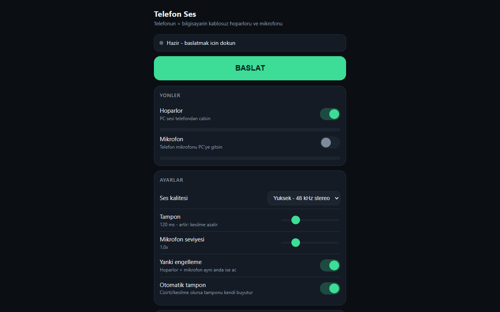

# Telefon Ses

Turns your phone into a wireless speaker and microphone for your Windows PC. Nothing to install on the phone: it runs in the browser.

[Türkçe (full guide and troubleshooting)](README.tr.md)



```
PC audio ──(WASAPI loopback)──► WebSocket ──► phone speaker
phone mic ──► WebSocket ──► virtual audio cable ──► Windows "microphone"
```

## Features

- **Two-way audio:** PC sound to the phone, phone microphone to Zoom, Discord or Teams
- **Live tuning:** quality from 24 kHz mono to 48 kHz stereo, adjustable 20–500 ms buffer
- **Latency breakdown:** shows network, buffer and phone output delay separately, so you can see where the delay comes from
- **Headset-free mode:** `--sanal` routes audio through a virtual cable, so sound still plays when no physical output is active
- **QR code pairing,** echo cancellation and support for multiple phones

Typical latency on the same Wi-Fi network is 130–250 ms. That works for music and video, but not for games.

## Quick start

1. Run `Baslat.bat`. Allow private network access if the Windows firewall asks.
2. Open the printed address on your phone, or scan the QR code in the terminal. The phone and PC must be on the same Wi-Fi network.
3. Accept the browser warning. The certificate is self-signed and generated locally, and the audio is still encrypted.
4. Press the green start button.

The microphone direction also needs [VB-CABLE](https://vb-audio.com/Cable/). Run `vbcable-kur.ps1` once, then restart the PC.

## How it works

- `sunucu.py` captures PC output with WASAPI loopback and streams 10 ms blocks of 16-bit PCM over WebSocket. Incoming mic packets pass through a jitter buffer and are written to the virtual cable.
- `web/index.html` plays audio with an AudioWorklet and a ring buffer that absorbs network gaps.
- HTTPS is required because browsers only allow microphone access on secure pages.

## Requirements

Windows and Python. Packages: `aiohttp comtypes cryptography numpy qrcode soundcard sounddevice`
